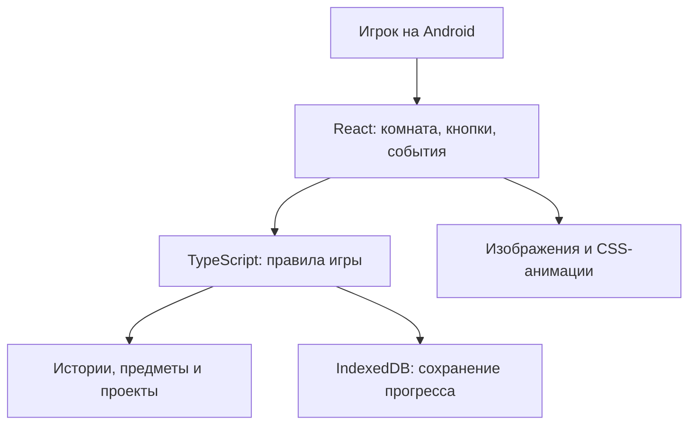

# Материалы проекта «Маша, не гори» для Codex

Этот файл объединяет предоставленные концепцию и технологические рекомендации. Исходные тексты сохранены полностью; в них есть как согласованные идеи, так и предложения и открытые вопросы — сохраняй эту разницу. Тексты написаны до создания приложения, поэтому фактическое состояние репозитория проверяй отдельно.

Полный подробный план разработки в предоставленных материалах отсутствует. Ниже приведён только этап 1 и предварительная оценка; не восстанавливай весь план предположениями.

## Состояние на момент передачи

По отчёту Codex пункты 1.1–1.3 выполнены: репозиторий создан, приложение React + TypeScript + Vite запускается и собирается, папки организованы. Подробности и актуальный статус проверь в Git. Впереди документация (1.4), правила агентов (1.5) и базовые проверки (1.6). Личная проверка пользователя запланирована после всего этапа 1.

## Этап 1. Подготовка проекта

- 1.1. Создать репозиторий: Git, .gitignore, начальный коммит.
- 1.2. Создать приложение: React, TypeScript, Vite; локальный запуск, сборка, стартовая страница и проверка браузером.
- 1.3. Организовать структуру для логики, интерфейса, событий, материалов, сохранений, тестов и документации.
- 1.4. Подготовить концепцию, технологии, план, инструкции по запуску, правила игры, решения и открытые вопросы.
- 1.5. Настроить AGENTS.md и при необходимости CLAUDE.md, правила изменений, проверок, отчётов и параллельной работы агентов.
- 1.6. Настроить Vitest, Playwright, проверку TypeScript и сборки; добавить проверки игровой логики при её появлении.

## Предварительная оценка трудозатрат

Оценка, а не обязательство или дедлайн: 150–250 часов пользователя с помощью Codex и Claude на первую законченную версию. Включает постановку задач, проверку работы, подготовку историй и картинок, тестирование на телефоне и исправления.

| Часть работы | Часы пользователя |
|---|---:|
| Подготовка проекта и первый прототип | 20–30 |
| События, проекты и игровой агент | 35–55 |
| Гусь, комната, покупки и концовки | 25–40 |
| Визуал, персонажи и анимация | 25–50 |
| Проверка, исправления и публикация | 45–75 |
| Итого | 150–250 |

Первый простой прототип для телефона предварительно оценивается в 20–30 часов. Количество историй, графика и результаты тестирования могут изменить оценку.

---

# Исходный материал 1: концепция

# «Маша, не сгори» 🪿

### Концепция игры

**Жанр:** уютная юмористическая игра с элементами симулятора жизни, заботы о персонаже и лёгкого управления ресурсами.

**Платформа первой версии:** игра по ссылке, адаптированная под вертикальный экран телефона.

**Продолжительность одной сессии:** примерно 10–15 минут.

**Язык:** русский.

**Для кого:** для людей, уставших от работы, любителей смешных жизненных ситуаций, разработчиков и всех, кто хотя бы раз просил ИИ помочь и потом удивлялся результату.

> **«Маша, не сгори» — это игра про девушку, которая мечтает спокойно посидеть в кресле-качалке и посмотреть сериал. Но у неё есть работа, сто идей, ИИ-агент с сомнительной инициативой и гусь, который появился без объяснений и теперь ведёт себя как владелец квартиры.**

Игрок помогает Маше проживать дни: работать, есть, отдыхать, заниматься проектами, обустраивать комнату и разбираться с неожиданностями. Маша разговаривает с игроком, комментирует его решения и иногда спорит.

Концепция ниже опирается на твои решения. Там, где деталей ещё не было, я сама предложила варианты. Их можно менять после первого прототипа и игровых проверок.

---

## 1. Главная идея

Игрок заботится о Маше, но не просто кормит её и следит за шкалами. Каждый день приносит **маленькие истории и решения**:

- поработать или сначала поесть;
- сделать задачу самой или попросить помощи у агента;
- проверить результат агента или довериться ему;
- заняться старым проектом или ухватиться за новую идею;
- потратить деньги на уютную комнату или оставить на пельмени;
- выяснить, что делает гусь, или притвориться, что всё нормально.

В игре нет необходимости выигрывать каждый день идеально. Забавные ошибки, странные решения и неожиданные последствия — часть удовольствия.

При этом игрок постепенно видит результат своих действий: Маша завершает проекты, зарабатывает деньги, обустраивает комнату, открывает истории и когда-нибудь всё-таки добирается до своего кресла-качалки.

### Главное ощущение от игры

> «Я зашла на десять минут помочь Маше спокойно прожить день. Теперь у меня три проекта, странный отчёт агента и гусь в кресле. Прекрасно».

---

## 2. Атмосфера и юмор

Игра выглядит уютно и дружелюбно: тёплая комната, выразительная Маша, немного бытового беспорядка, чашка чего-нибудь вкусного и вещи, которые появляются по мере развития.

Юмор строится на узнаваемых ситуациях, лёгкой сатире на работу, IT-шутках, абсурде и неожиданных деталях. Технические шутки могут радовать разработчиков, но смысл событий должен быть понятен и без знания программирования.

**В игре нет мата, политики, религии и других острых тем.** Вместо ругательств Маша использует выражения вроде «ёшкин кот», «мамочки-пельмешечки» и «да чтоб тебя тесты покрыли».

Абсурд появляется на фоне обычной жизни: агент ведёт себя слишком уверенно, гусь вмешивается без приглашения, а новая идея возникает именно тогда, когда Маша наконец решила отдыхать.

---

## 3. Главная героиня

### Маша

Маша — самостоятельный персонаж, вдохновлённый тобой. Она весёлая, активная, боевая и любопытная. Она умеет решать сложные задачи, любит узнавать новое и замечает возможности там, где другие видят только проблемы.

Её слабость — интерес ко всему сразу. Если рядом появляется идея, Маша уже мысленно придумывает название, план запуска и список будущих возможностей. А потом вспоминает, что вообще-то собиралась пообедать.

### Её мечта

Маша хочет поставить дома **кресло-качалку**, завернуться в плед и спокойно смотреть сериалы.

В теории это несложно.

На практике:

- сначала нужно закончить задачу;
- потом у неё появляется идея;
- потом агент говорит, что всё готово;
- потом выясняется, что не всё;
- потом в кресле кто-то сидит.

Этот образ проходит через всю игру и становится одновременно шуткой, частью развития комнаты и одной из долгосрочных целей.

### Отношения с игроком

Игрок не создаёт личность Маши с нуля: у неё есть свой характер. Но он направляет её действия и помогает принимать решения.

Маша периодически обращается прямо к игроку:

> **Маша:** Ты точно хочешь открыть ещё один проект?  
> **Игрок:** Я? Это ты его придумала.  
> **Маша:** Да, но теперь мы в этом вместе.

Или:

> «Спасибо, что покормили. Я уже начала рассматривать кофе как суп».

Её комментарии меняются в зависимости от состояния, событий и последних действий игрока.

На первом этапе внешность Маши не меняется. Дополнительных постоянных персонажей — друзей, родственников и коллег — пока не вводим.

---

## 4. Что делает игрок

Основной игровой процесс — это короткий цикл:

**посмотреть, как дела у Маши → выбрать действие → столкнуться с событием → принять решение → увидеть последствия → продвинуться к цели.**

В течение игрового дня можно:

1. Позаботиться о Маше: покормить, дать отдохнуть, восстановить силы.
2. Поработать и получить деньги.
3. Заняться одним из проектов.
4. Поручить задачу ИИ-агенту и проверить результат.
5. Ответить на случайное событие.
6. Купить предмет или улучшить комнату.
7. Завершить день и посмотреть итоги.

Все действия сопровождаются короткими реакциями Маши, изменениями показателей или небольшими историями. Игрок должен понимать, почему что-то произошло и какой выбор у него есть.

---

## 5. Как проходит игровой день

Игровой день — основная единица прохождения.

### Утро

Маша просыпается. Игрок видит:

- состояние Маши;
- доступные деньги;
- активные проекты;
- рабочую задачу или план на день;
- комнату и доступные действия.

Маша может прокомментировать начало дня:

> «Сегодня я всё успею, хорошо поем и лягу вовремя».

Игра деликатно не отвечает на это обещание.

### День

Игрок выбирает несколько действий. Они занимают условное игровое время и меняют состояние.

Например:

1. Позавтракать.
2. Выполнить рабочую задачу.
3. Попросить агента помочь с проектом.
4. Проверить его результат.
5. Отдохнуть.
6. Разобраться с неожиданным событием.

Точное количество действий и продолжительность дня подберём на прототипе. **Рабочий ориентир — один день примерно за 10–15 минут**, но если игроки захотят более короткие сессии, день можно сделать с возможностью остановиться и продолжить позже.

### Вечер

День заканчивается, когда игрок решает завершить его или подходит к концу доступное время. Если Маша сильно устала, она может закончить день раньше.

Игрок видит итоги:

> **День 4 завершён**
>
> Задач выполнено: 2  
> Денег заработано: 120  
> Проектов завершено: 1  
> Новых идей: 2  
> Приёмов пищи: 1  
> Подозрительных гусячьих действий: 3
>
> **Маша:** «Вообще-то я молодец. Но завтра надо поесть раньше».

Затем можно начать следующий день. Состояние и прогресс сохраняются.

---

## 6. Показатели и ресурсы

Мы зафиксировали шесть показателей.

| Показатель | Что отражает | Как используется |
|---|---|---|
| ⚡ **Энергия** | Насколько Маша бодрая | Расходуется на работу и дела, восстанавливается отдыхом |
| 🍕 **Сытость** | Насколько Маша сыта | Снижается в течение игрового дня, восстанавливается едой |
| 🧠 **Кукуха** | Эмоциональное состояние | Снижается от напряжения и неприятностей, восстанавливается приятными действиями |
| 💰 **Деньги** | Доступные средства | Нужны для еды, предметов и обустройства комнаты |
| ✨ **Мотивация** | Желание и готовность заниматься делами | Влияет на некоторые действия и события, связанные с проектами |
| 💡 **Незаконченные проекты** | Идеи, которые Маша взяла в работу | Дают цели и возможности развития, но могут создавать дополнительную суету |

### Как это выглядит для игрока

Энергию, сытость, кукуху и мотивацию можно показывать шкалами. Деньги — числом, проекты — отдельным счётчиком и списком.

Интерфейс подсказывает состояние понятными словами:

- «бодрая»;
- «пора бы перекусить»;
- «кукуха держится»;
- «Маша очень устала».

Точные значения эффектов — например, сколько энергии тратится на работу, — настроим после игровых проб. Сейчас важнее определить понятные связи.

### Взаимодействие показателей

- Если Маша голодна, работа утомляет сильнее.
- Если она очень устала, некоторые действия становятся менее выгодными.
- Отдых и удачное завершение задачи могут повышать мотивацию.
- Слишком много незаконченных проектов открывают события про накопившиеся дела.
- Неприятности с агентом могут снизить кукуху, а успешное сотрудничество — улучшить настроение или сэкономить силы.

**Игрок заранее видит основные последствия действий.** Случайные события могут удивлять, но игра не должна скрытно наказывать за обычный выбор.

### Пока игра закрыта

Ничего плохого с Машей не происходит. Она не голодает, не выгорает и не тратит деньги, пока игрок занимается своей жизнью.

---

## 7. Забота о Маше

Забота должна быть разнообразной, но простой. Это короткие действия с понятным эффектом и характерными реакциями.

### Еда

| Действие | Результат | Комментарий |
|---|---|---|
| Быстрый перекус | Немного восстанавливает сытость | «Это считается завтраком. Наверное» |
| Пельмени | Хорошо восстанавливают сытость и немного улучшают настроение | «Маленькие мешочки стабильности» |
| Нормальный обед | Хорошо восстанавливает сытость | «Оказывается, еда бывает не рядом с клавиатурой» |
| Кофе | Ненадолго помогает взбодриться, но не заменяет сон и еду | «Я бодра. Кажется, даже слишком» |

Еду можно покупать за игровые деньги. При этом в базовом наборе действий всегда должна оставаться доступная возможность восстановиться, чтобы игрок не оказался в тупике из-за нехватки средств.

### Отдых

- **Вздремнуть** — восстановить энергию.
- **Посмотреть серию** — поднять кукуху.
- **Прогуляться** — немного восстановить силы и настроение.
- **Позаботиться о растении** — получить небольшой приятный эффект или событие.
- **Отметить победу** — поднять мотивацию после завершённого дела.
- **Полежать пять минут** — отдохнуть с шансом на забавное событие.

Например:

> Маша легла на пять минут.
>
> Через некоторое время она обнаружила:
>
> **А.** Новую идею приложения.  
> **Б.** Пульт от телевизора.  
> **В.** Гуся.  
>
> Гусь утверждает, что лежал здесь первым.

---

## 8. Работа и деньги

Работа даёт Маше деньги и приносит события. Игроку не нужно разбираться в реальной разработке: рабочие задачи описаны понятным языком.

Например:

> **Рабочая задача:** подготовить отчёт.
>
> Коллеги попросили показать, что уже сделано. Попросили «коротко, но подробно».
>
> Что делает Маша?
>
> - Пишет отчёт самостоятельно.
> - Просит агента подготовить черновик.
> - Сначала уточняет, кому и зачем нужен отчёт.

У каждого варианта есть последствия. Агент может сэкономить время, но его результат желательно проверить. Самостоятельная работа надёжнее в одних ситуациях, но может потребовать больше энергии.

### Примеры рабочих событий

- Задача с пометкой «срочно», которую никто не описал.
- Совещание, содержание которого помещается в одно сообщение.
- Просьба сделать «маленькую правку» в пятницу вечером.
- Отчёт, в котором хочется написать «я старалась».
- Проект, который неожиданно работает с первого запуска.
- Коллега просит «быстро посмотреть», а открывает целый новый мир.

В первой версии коллеги и руководитель могут существовать только в сообщениях и событиях: без отдельных постоянных персонажей и сложной системы отношений.

---

## 9. Личные проекты

У Маши периодически появляются новые идеи. Проекты дают ощущение движения и становятся источником историй.

### Как появляется проект

Во время событий или отдыха Маша может предложить идею:

> «А что если сделать приложение, которое напоминает разработчикам поесть?»
>
> - **Записать идею на потом.**
> - **Начать проект.**
> - **Попросить агента помочь разобраться.**

Игрок не обязан начинать каждый проект. Идею можно оставить в списке и вернуться позже.

### Работа над проектом

У каждого проекта есть простая шкала готовности:

**Идея → В работе → Почти готово → Завершён.**

Игрок может:

- потратить время Маши;
- попросить агента выполнить часть задачи;
- отложить проект;
- завершить его и получить награду.

Награда может включать деньги, мотивацию, предмет, новую историю или просто смешной итог.

### Зачем учитывать незаконченные проекты

Если их слишком много, Маша чаще получает события вроде:

> «Маша открыла список своих проектов. Список проектов открыл список своих проектов».

Это может немного влиять на кукуху или мотивацию, но количество проектов само по себе не должно немедленно вести к проигрышу. Игроку оставляют возможность спокойно вернуться к ним или отложить часть идей.

---

## 10. ИИ-агент

### Кто он

Для концепции предлагаю **одного постоянного агента**. Он появляется в виде небольшого персонажа в компьютере Маши.

Его характер:

- доброжелательный;
- очень уверенный в себе;
- иногда слишком инициативный;
- способен действительно помогать;
- умеет представить любую ситуацию как «работа выполнена успешно».

Он не злодей и не ходячая ошибка. Иногда он прекрасно справляется. Иногда ошибается. Иногда делает именно то, что попросили, и только потом становится понятно, что попросить стоило иначе.

> **Агент:** «Я всё подготовил».  
> **Маша:** «А что именно?»  
> **Агент:** «Ответ на этот вопрос подготовлен в следующем отчёте».

### Что он умеет

Агент может помогать:

- составлять планы;
- готовить тексты и отчёты;
- выполнять часть рабочих задач;
- искать идеи;
- помогать с личными проектами;
- предлагать решения бытовых вопросов.

### Проверка работы агента

Проверка — небольшая игровая задачка. Игрок получает исходное поручение и результат, после чего выбирает действие.

**Пример:**

> **Задание:** составить список продуктов для пельменного ужина на двоих.
>
> **Отчёт агента:**
>
> - Пельмени — 1 упаковка.
> - Сметана — 1 банка.
> - Фейерверк — 12 штук.
>
> **Агент:** «Добавил праздничную атмосферу».
>
> Что делаем?
>
> - Убираем фейерверк и принимаем список.
> - Принимаем всё.
> - Просим переделать.

Последствия могут быть смешными и разными. Важно, чтобы игрок мог понять проблему без специальных знаний.

Другой пример — уже для разработчиков, но тоже с понятным объяснением:

> **Агент:** «Задача выполнена, всё проверено».
>
> В отчёте указано: **проверки не запускались**.
>
> - Попросить запустить проверки.
> - Принять результат.
> - Уточнить, что именно агент проверил.

### Принципы механики

- Агент **иногда приносит хороший результат**.
- Ошибки отличаются: что-то пропущено, добавлено лишнее, перепутаны условия, не выполнена проверка.
- Не каждое задание превращается в экзамен.
- Ошибка игрока приводит к событию или небольшим последствиям, а не обязательно к катастрофе.
- Игрок видит, что ИИ полезен в работе и быту, если понимать задачу и проверять важное.

Для первой версии агент работает на **заранее написанных сценариях**. Настоящее подключение к ИИ пока не требуется: сначала проверим, интересна ли сама игра.

---

## 11. Гусь 🪿

### Кто он

Гусь — загадочный постоянный элемент игры. Его никто не приглашал, но он появляется в самых разных местах и постепенно ведёт себя всё увереннее.

Он может:

- помочь;
- помешать;
- украсть вещь;
- молча пройти по комнате;
- занять кресло;
- неожиданно решить проблему;
- создать новую проблему и уйти.

Его действия подчиняются **гусиной логике**. Она существует, но Маша пока не получила к ней доступ.

### Как он появляется

Иногда гусь — полноценное событие с выбором. Иногда он просто мелькает в комнате или оставляет след.

Примеры:

1. На столе была булочка. Теперь на столе записка: «Булочка была хорошей».
2. Агент сообщает, что задача выполнена. В отчёте обнаруживается подпись гусиной лапой.
3. Гусь проходит через экран с флешкой.
4. Маша наконец купила кресло-качалку. Гусь уже сидит в нём.
5. Игрок проверяет отчёт агента, а внизу написано: «Проверено гусем».
6. Гусь приносит забытый бутерброд. Никто не знает, откуда он его взял.
7. Маша спрашивает, где зарядка. Гусь перестаёт смотреть ей в глаза.

### Взаимодействие с гусем

В отдельных событиях игрок может:

- угостить гуся;
- поговорить с ним;
- попросить вернуть вещь;
- проигнорировать происходящее;
- проверить, что он натворил.

Иногда наградой будет просто шутка, иногда — предмет, полезное событие или открытие новой истории.

### Тайна гуся

Полностью объяснять его происхождение на старте не будем. Можно оставить редкие намёки на то, что он знает об игре больше остальных.

> **Маша:** «Откуда здесь гусь?»  
> **Агент:** «В требованиях гусь не указан».  
> **Гусь:** «Га».  
> **Агент:** «Прошу прощения. Гусь был в требованиях всегда».

---

## 12. События и истории

События — главный источник юмора и разнообразия. Каждое короткое событие состоит из ситуации, одного или нескольких вариантов выбора и результата.

### Рабочие

> Пришла задача: «Нужно вчера».
>
> - Уточнить, что нужно.
> - Попросить агента разобраться.
> - Спросить, какой вчера.

### Жизненные

> Маша открыла холодильник. Холодильник тоже не ожидал этой встречи.
>
> - Приготовить обед.
> - Заказать еду.
> - Поискать пельмени поглубже.

### Про идеи

> Маша решила отдохнуть и посмотреть сериал. Во время заставки у неё появилась идея приложения.
>
> - Записать и продолжить смотреть.
> - Немедленно начать проект.
> - Поручить агенту составить короткий план.

### Про агента

> Агент сообщает: «Я оптимизировал ваш день».
>
> В расписании теперь:
>
> - 09:00 — работать;
> - 13:00 — работать;
> - 18:00 — работать;
> - 23:00 — оценить эффективность.
>
> Маша смотрит на игрока.

### Про гуся

> Гусь принёс Маше тапок.
>
> Это не Машин тапок.
>
> - Поблагодарить.
> - Уточнить, чей он.
> - Не задавать вопросов, пока целы собственные тапки.

Часть событий будет самостоятельной, а часть — продолжаться в следующие дни. Например, гусь однажды принёс тапок, а через несколько дней у Маши появляется коллекция, которую никто не просил собирать.

---

## 13. Комната и обустройство

Комната — главный экран игры и видимый результат прогресса.

В начале она простая, но уютная:

- стол;
- компьютер;
- стул;
- кружка;
- полка;
- немного свободного места;
- подозрительно подходящий для гуся угол.

За игровые деньги Маша покупает предметы:

- растение;
- лампу;
- плед;
- кружку;
- полку для идей;
- коврик;
- кресло-качалку;
- телевизор или экран для сериалов;
- гусятницу, назначение которой лучше не уточнять.

### Что дают предметы

На первом этапе предметы в основном **меняют внешний вид комнаты** и иногда открывают реплики или события.

Некоторые могут давать небольшие игровые возможности:

- плед — новый вариант отдыха;
- растение — короткое приятное действие;
- кресло — отдельные события и продвижение к мечте;
- большая полка — визуально хранит завершённые проекты или памятные предметы.

Точные эффекты подберём так, чтобы покупки были приятным дополнением, а не обязательной гонкой.

### Главное приобретение — кресло-качалка

Кресло — заметная цель, но его покупка не обязана означать окончание игры. Наоборот, она открывает новую главу:

> «Теперь у Маши есть кресло-качалка. Осталось найти время в него сесть».

При этом иногда в нём уже может оказаться гусь. Или агент. Или стопка новых идей.

---

## 13. Прогресс и причины вернуться

Игрок постепенно открывает:

- новые события;
- новые проекты;
- предметы для комнаты;
- дополнительные реакции Маши;
- истории агента;
- редкие появления гуся;
- достижения и необычные концовки.

Прогресс не должен требовать ежедневного входа. Игрок возвращается потому, что ему интересно узнать, **что случится дальше**, а не потому, что иначе Маша заболеет и все растения обидятся.

### Примеры достижений

- **«Вообще-то я ела»** — вовремя позаботиться о сытости.
- **«Доверяй, но проверяй»** — заметить ошибку агента.
- **«Агент тоже молодец»** — принять корректно выполненную задачу.
- **«Одна серия — и спать»** — посмотреть сериал после рабочего дня.
- **«Я только записала идею»** — сохранить новую идею, не начиная проект.
- **«Вот это поворот»** — завершить проект.
- **«Кресло существует»** — купить кресло-качалку.
- **«Кресло существует, Маша нет»** — обнаружить в нём гуся.
- **«Мы просто коллеги»** — несколько раз поработать с агентом.
- **«Гусь в курсе»** — встретить редкое событие.

---

## 14. Победа, проигрыш и необычные концовки

Игра остаётся лёгкой, но проигрыш возможен — через **необычные концовки**, как ты и хотела.

Игрок заранее получает сигналы, если Маша приближается к тяжёлому состоянию. У него есть шанс изменить планы, поесть и отдохнуть.

Предлагаю разделить два уровня последствий:

### Раннее окончание дня

Если Маша очень устала, она может уснуть или отказаться продолжать работу. День закончится, но на следующий можно будет продолжить игру.

> «Маша сказала, что ещё немножко поработает, и уснула на слове “немножко”».

### Особая концовка прохождения

Если игрок долго игнорирует состояние Маши или складывается редкое сочетание событий, открывается одна из необычных концовок.

Например:

**«Кукуха взяла отпуск»**

> Маша закрыла ноутбук.  
> Ноутбук закрыл проект.  
> Проект закрылся сам.  
> Агент пообещал разобраться, когда вернётся из отпуска.  
> Гусь был единственным, кто сохранил спокойствие.

**«Слишком много идей»**

> Маша открыла очередной проект и наконец поняла, что не помнит, какой из них был первым.  
> Агент предложил сделать приложение для учёта проектов.  
> Маша согласилась.

**«Гусиное управление»**

> Гусь занял кресло, получил доступ к календарю и назначил встречу на семь утра.  
> Маша поняла, что пора что-то менять.

После концовки игрок сможет начать новое прохождение. **Сохранять ли при этом открытые достижения и предметы — пока предлагаю решить после прототипа**, когда увидим, насколько длинной получится игра.

---

## 15. Как выглядит игра

### Экран

Первая версия рассчитана на вертикальный экран телефона.

На основном экране:

- в центре — комната и Маша;
- сверху — основные показатели;
- ниже или сбоку — доступные действия;
- отдельно — деньги и кнопка проектов;
- события открываются поверх комнаты в виде понятных карточек.

Экран не должен быть перегружен: игроку не нужно одновременно читать шесть таблиц и искать гуся под лупой.

### Стиль

Предлагаю **мягкий мультяшный стиль**:

- тёплые цвета;
- уютная комната;
- выразительные эмоции Маши;
- милый, но подозрительный гусь;
- детали, которые смешно разглядывать.

Маша может быть вдохновлена тобой, при этом не обязательно добиваться фотографического сходства. Главное — характер, эмоции и узнаваемое настроение.

### Состояния Маши

Для начала можно подготовить несколько изображений:

- обычная;
- радостная;
- уставшая;
- удивлённая;
- довольная после еды;
- «кукуха смотрит на нас издалека».

Полноценная сложная анимация для первого прототипа не нужна. Небольшие движения можно добавлять постепенно: моргание, смену выражения, появление гуся.

### Звук

В будущем игре подойдут спокойная фоновая музыка и короткие смешные звуки. Для первой версии звук необязателен; если добавим, предусмотрим возможность его отключить.

---

## 16. Пример первых 10–15 минут

### Начало

Игрок открывает игру. Маша сидит за столом.

> **Маша:** Привет! Сегодня у меня простой план: поработать, поесть, отдохнуть и посмотреть сериал.
>
> **Маша:** Думаю, мы обе понимаем, что что-то из этого плана окажется фантастикой.

Появляются показатели и первые доступные действия.

### Первая задача

Маше приходит просьба подготовить короткий отчёт. Игрок может сделать его самостоятельно или попросить агента.

Если выбрать агента:

> **Агент:** Отчёт готов. Я всё проверил.
>
> В отчёте: «Проверки: не запускались».

Игрок выбирает, что делать. Маша реагирует, а состояние или результат задачи меняются.

### Первый приём пищи

Маша сообщает:

> «Кажется, я сегодня ещё ничего не ела. Кофе ведь не считается супом?»

Игрок выбирает еду и видит, как меняется сытость.

### Новая идея

После еды Маша предлагает проект:

> «А что если сделать приложение, которое напоминает людям есть? Я бы точно им пользовалась. Наверное».

Игрок может начать проект или записать идею на потом.

### Гусь

Пока открыта комната, по заднему плану проходит гусь. Он ничего не говорит и исчезает.

Чуть позже приходит сообщение:

> **Агент:** «В системе обнаружен новый пользователь».  
> **Маша:** «Это кто?»  
> **Агент:** «Имя пользователя: Гусь. Права: уточняются».

### Итог

Игрок заканчивает день, получает деньги за работу, видит последствия выбора и может начать следующий день.

Этот сценарий — **рабочий пример для прототипа**. После первых проб станет понятно, где нужен более быстрый темп, больше выбора или другая шутка.

---

## 17. Первая версия игры

Чтобы проверить задумку, предлагаю первую версию ограничить **небольшой, но законченной игрой на несколько дней**.

### Что в неё входит

- одна комната;
- Маша с несколькими выражениями лица и репликами;
- шесть согласованных показателей;
- игровые дни и итоги;
- работа, еда, отдых и простые покупки;
- несколько небольших проектов;
- один агент с заранее написанными заданиями и отчётами;
- несколько гусиных событий;
- подборка рабочих и жизненных историй;
- возможность купить несколько предметов, включая кресло;
- сохранение прогресса на устройстве;
- как минимум одна обычная цель и одна необычная концовка;
- удобное управление на телефоне.

Количество историй и проектов уточним, когда проверим, сколько занимает один день и как часто повторяются события.

### Что можно добавить после проверки первой версии

- больше комнат и возможностей их оформления;
- дополнительные длинные сюжетные линии;
- новых постоянных персонажей;
- несколько агентов;
- выбор внешности Маши;
- более сложную анимацию и звук;
- синхронизацию прогресса между устройствами;
- настоящий ИИ для диалогов или событий;
- отдельное мобильное приложение;
- монетизацию.

Это не список отменённых идей: он помогает сделать первую игру достаточно небольшой, чтобы в неё можно было сыграть и понять, чего хочется дальше.

---

## 18. Как поймём, что концепция работает

Первая проверка — дать игру нескольким людям и посмотреть:

- понимают ли они, что делать без длинной инструкции;
- нравится ли им проводить время с Машей;
- читают ли они события и реагируют ли на юмор;
- понимают ли, как помогают и ошибаются агенты;
- интересно ли им возвращаться к проектам;
- замечают ли гуся и хочется ли узнать о нём больше;
- хотят ли они начать ещё один игровой день;
- не раздражает ли необходимость следить за показателями.

Самый хороший результат первого теста:

> **«Я думала, зайду на пять минут, а уже купила кресло, проверила агента и ищу гуся».**

---

## 19. На чём держится игра

У концепции четыре опоры:

1. **Уютная забота о Маше.** Игрок помогает ей справляться с делами и не забывать о себе.
2. **Смешные жизненные истории.** Ситуации знакомы не только разработчикам.
3. **Полезный, но требующий внимания агент.** Он помогает, ошибается и создаёт поводы для игры.
4. **Непредсказуемый гусь.** Он добавляет абсурда, секретов и ощущения, что в этой комнате происходит что-то ещё.

А над всем этим — Маша с её мечтой о кресле, сериалами и способностью найти новую идею в любой ситуации.

> **Игра о том, что можно быть активной, любопытной и придумывать сто проектов — но поесть и отдохнуть тоже неплохо. Особенно если гусь ещё не занял кресло.** 🪿

---

# Исходный материал 2: технологии

Маша, с твоей концепцией нам **не обязательно начинать с разработки нативного Android-приложения или изучения игрового движка**. Игра в основном состоит из комнаты, персонажей, кнопок, карточек событий и изменений показателей — это удобно сделать как интерактивное веб-приложение, которое хорошо работает на телефоне.

В концепции первая версия как раз описана **как игра по ссылке**. Поэтому я бы выбрала такой путь:

> **Сначала — игра по ссылке, адаптированная под Android. Затем — возможность установить её на телефон. Если игра зайдёт и захочется публиковать её в магазине, подготовим Android-приложение на основе того же проекта.**

Ты сможешь открывать игру на своём Android и отправлять ссылку другим людям для тестирования. Для разработки нам понадобится преимущественно **TypeScript**, но твой опыт C# никуда не пропадёт: модели, состояния, бизнес-правила, тесты и архитектура остаются знакомыми.

## 1. Основной технологический стек

| Для чего | Технология | Что она будет делать в игре |
|---|---|---|
| Язык программирования | **TypeScript** | Описывать Машу, показатели, действия, события, проекты и игровые правила |
| Интерфейс | **React** | Показывать комнату, шкалы, кнопки, карточки событий и диалоги |
| Внешний вид и простые движения | **CSS** | Адаптировать игру под экран телефона, оформлять элементы и анимировать появления |
| Создание и сборка проекта | **Vite** | Запускать игру на компьютере во время разработки и собирать готовую версию |
| Данные игры | **JSON / TypeScript-файлы** | Хранить тексты событий, реплики, предметы, проекты и их параметры |
| Сохранение прогресса | **IndexedDB** | Хранить на телефоне состояние игры: день, показатели, покупки и проекты |
| Установка на телефон | **PWA** | Позволить добавить игру на главный экран и запускать её как отдельное приложение |
| Проверка игровой логики | **Vitest** | Проверять, например, изменение показателей, покупку предметов и последствия выбора |
| Проверка игры в браузере | **Playwright** | Проверять основные действия игрока: открыть игру, пройти событие, сохранить и продолжить |
| Исходный код и история | **Git + GitHub** | Хранить проект, изменения и совместную работу с агентами |
| Публикация по ссылке | **GitHub Pages** как стартовый вариант | Разместить готовую игру, чтобы открывать её с телефона |
| Графика | **ChatGPT / генерация изображений + графический редактор** | Создавать комнату, Машу, гуся, предметы и при необходимости дорабатывать их |

React официально поддерживает работу с TypeScript, а его документация приводит Vite как один из способов создания проекта. [React](https://react.dev/learn/typescript?utm_source=chatgpt.com)

**Вывод:** для первой версии это будет не «большой сайт с сервером», а небольшая игра, которая загружается по ссылке и выполняется прямо на устройстве игрока.

---

## 2. Почему я предлагаю TypeScript, если ты C#-разработчик

Потому что мы выбрали игру по ссылке, а браузерная экосистема TypeScript хорошо подходит для такого формата и для работы с агентами.

Но это не означает, что тебе придётся учиться программировать заново. Например, игровую модель можно воспринимать почти так же, как в C#:

```typescript
interface GameState {
  day: number;
  energy: number;
  satiety: number;
  sanity: number;
  money: number;
  motivation: number;
  unfinishedProjects: string[];
}
```

Это тот же объект состояния игры. Агент пишет реализацию, а ты можешь проверять знакомые вещи:

- где хранится состояние;
- как меняются показатели;
- можно ли уйти в отрицательные деньги;
- корректно ли обрабатывается сохранение;
- не смешана ли игровая логика с интерфейсом;
- что произойдёт, если игрок закрыл телефон посреди события.

TypeScript отличается синтаксисом и особенностями платформы, но **логика разработки тебе уже знакома**.

При этом мы не обязаны притворяться, что C# не существует: альтернативу на C# я покажу ниже.

---

## 3. Как технологии будут работать вместе



Например, игрок нажимает **«Поесть пельмени»**:

1. Интерфейс передаёт игровой логике выбранное действие.
2. Логика проверяет, достаточно ли денег.
3. Изменяет сытость, деньги и, возможно, кукуху.
4. Возвращает реплику Маши.
5. Игра обновляет экран и сохраняет состояние на устройстве.

Если игрок закроет игру и вернётся позже, она восстановит сохранённый день. Пока игра закрыта, показатели не меняются — как и задумано в концепции.

Здесь же важно разделить две вещи:

- **Разработческие агенты Codex и Claude** помогают нам создавать игру.
- **Агент внутри игры** в первой версии — игровой персонаж с заранее написанными заданиями, ответами и ошибками.

Для игрового агента на старте не нужны настоящий ИИ, API-ключи и оплата запросов. При этом он вполне может выдавать разные отчёты и попадать в неожиданные ситуации за счёт написанных нами сценариев.

---

## 4. Будет ли это ощущаться как игра, а не как сайт?

**Может ощущаться как полноценная мобильная игра**, если правильно сделать визуал и управление:

- вертикальный экран;
- комната и персонажи занимают основное пространство;
- крупные удобные кнопки;
- карточки событий появляются поверх комнаты;
- Маша меняет выражение лица;
- гусь внезапно проходит через экран и исчезает по своим гусиным делам;
- нет необходимости вводить адрес при каждом запуске.

Здесь важны рисунки, звук, анимация, игровой темп и интерфейс. Наличие игрового движка само по себе не делает проект более «игровым».

Для начала анимацию можно делать средствами **CSS**: появление карточек, покачивание предметов, смена эмоций, движение гуся. Если позже захочется сложных сцен, мы отдельно оценим, нужен ли специализированный инструмент.

### Что такое PWA

PWA — это веб-приложение, которое можно добавить на главный экран телефона. На Android оно может запускаться в отдельном окне с собственной иконкой.

Для полноценной работы без интернета нужно **отдельно настроить загрузку и кэширование игры**: установка PWA сама по себе этого не гарантирует. План такой: первый запуск с интернетом, после загрузки необходимых файлов — возможность продолжать играть офлайн. Это нужно проверить на твоём телефоне. [MDN](https://developer.mozilla.org/en-US/docs/Web/Progressive_web_apps/Guides/Installing?utm_source=chatgpt.com)

Для игры в дороге это прямо полезная функция.

---

## 5. Графика: из чего будет собрана комната

Чтобы комната не была одной неподвижной картинкой, я предлагаю собирать её из отдельных элементов:

| Элемент | Как использовать |
|---|---|
| Фон комнаты | Основа сцены |
| Маша | Отдельное изображение поверх фона |
| Эмоции Маши | Несколько вариантов лица или персонажа |
| Гусь | Отдельный персонаж, который может появляться в разных местах |
| Мебель | Отдельные изображения кресла, лампы, растения и других предметов |
| Интерфейс | Шкалы, кнопки, карточки и подписи, созданные средствами React и CSS |

Например, игрок покупает кресло — игра показывает изображение кресла в комнате. Потом случается событие — поверх кресла появляется гусь.

Для прозрачных персонажей и предметов подойдут **PNG или WebP с прозрачным фоном**. Что именно выбрать для итоговых файлов, решим после проверки качества и размера изображений.

Для создания графики можно использовать генерацию изображений, но нужно будет уделить внимание **единому стилю**: чтобы Маша, гусь и мебель выглядели обитателями одной игры. Скорее всего, изображения придётся дорабатывать и проверять вручную.

**Сложная покадровая анимация на старте не нужна.** Первая версия может быть выразительной и с несколькими позами, сменой эмоций и небольшими движениями.

---

## 6. Хранение игры и прогресса

### Где будет храниться код

В репозитории GitHub:

```text
Код игры
Истории и реплики
Изображения
Тесты
Документация
Инструкции для Codex и Claude
```

Ты сможешь работать привычно: ветки, коммиты, проверка изменений, отдельные задачи для агентов.

### Где будет храниться прогресс игрока

На его устройстве, в браузерном хранилище **IndexedDB**. Это позволяет сохранять структурированные данные прямо в браузере. [MDN](https://developer.mozilla.org/en-US/docs/Web/API/IndexedDB_API?utm_source=chatgpt.com)

Нужно сразу предусмотреть:

- автосохранение после значимых действий;
- версию формата сохранения, чтобы обновления игры могли работать со старыми данными;
- проверку повреждённого сохранения;
- кнопку **«Начать заново»** с подтверждением;
- желательно — **экспорт и импорт сохранения файлом**.

Последний пункт полезен, потому что локальное сохранение не равно облачному: при очистке данных браузера или смене устройства прогресс может потеряться. И данные игры в разных браузерах обычно не общие. Браузер может также ограничивать или очищать хранилище; запрос постоянного хранения помогает снизить риск, но не заменяет резервную копию. [MDN](https://developer.mozilla.org/en-US/docs/Web/Progressive_web_apps/Guides/Installing?utm_source=chatgpt.com)

Сервер и аккаунты для такой первой версии не требуются.

---

## 7. Как ты будешь проверять игру на Android

Тебе **достаточно твоего телефона**. Для первого этапа отдельный эмулятор и Android Studio не обязательны.

Рабочий цикл может быть таким:

1. Codex или Claude меняет игру на компьютере.
2. Агент запускает сборку и автоматические проверки.
3. Ты открываешь игру в браузере компьютера и смотришь результат.
4. Затем открываешь её **на своём Android**.
5. Проверяешь, удобно ли нажимать, читать, закрывать события и продолжать игру.
6. Замечания превращаем в конкретные задачи агенту.

Во время разработки телефон можно подключать к локально запущенному проекту через общую сеть — когда дойдём до этого, настроим вместе. Для проверки по опубликованной ссылке понадобится разместить сборку на хостинге.

Особенно важно проверить на реальном телефоне:

- помещаются ли шкалы и кнопки;
- читаются ли длинные события;
- не перекрывает ли интерфейс системная панель;
- что происходит при сворачивании и возвращении в игру;
- сохраняется ли прогресс после закрытия;
- работает ли игра без сети после первоначальной загрузки;
- не расходует ли она слишком много памяти и заряда.

---

## 8. Как работать с Codex и Claude

Можно организовать работу примерно так же, как ты уже делаешь в Line, только без необходимости сразу строить огромную систему управления проектом.

### Что подготовить в репозитории

**`AGENTS.md`** — общие правила проекта: архитектура, проверки, работа с файлами и ограничения.

Для Claude можно добавить **`CLAUDE.md`**, который будет ссылаться на общие правила и дополнять их, если понадобится.

Отдельно:

- концепция игры;
- описание игрового состояния и правил;
- список задач и их статус;
- описание визуального стиля и персонажей;
- правила работы с игровым контентом;
- инструкция по запуску и проверке на телефоне.

### Как делить работу агентам

Например:

| Агент | Задача |
|---|---|
| Codex | Реализовать состояние игры, действия и сохранение |
| Claude | Предложить и написать игровые события по заданному формату |
| Codex | Подключить события к интерфейсу и добавить проверки |
| Ты | Решить, смешно ли, удобно ли и соответствует ли поведение задумке |

Агенты могут работать и над кодом, и над текстами, и над проверками. Но важно, чтобы они **не меняли одни и те же файлы одновременно без координации**. Если запускать их параллельно, лучше разделять задачи и ветки или рабочие копии.

И да: поскольку игра частично про агента, который уверенно сообщает «всё готово», у нас есть исторический шанс сделать разработку максимально аутентичной. 😄

---

## 9. Какие проверки действительно нужны

Не предлагаю покрывать тестами каждую фразу гуся. Но основные игровые правила лучше проверить автоматически.

### Игровая логика — Vitest

Например:

- еда повышает сытость;
- покупка списывает деньги и добавляет предмет;
- нельзя купить предмет без нужной суммы;
- показатели не выходят за допустимые границы;
- завершение дня сохраняет результат;
- последствия события применяются один раз;
- сохранение восстанавливается после перезапуска.

### Сценарий игрока — Playwright

Например, один сквозной сценарий:

> Начать игру → поесть → выполнить задачу → встретить гуся → закрыть и открыть игру → увидеть сохранённый прогресс.

Автоматическая проверка на мобильном размере экрана полезна, но она **не заменяет твой Android**: реальный телефон покажет проблемы с касанием, производительностью и установкой PWA.

---

## 10. Публикация и будущий Android

### Сначала — ссылка

Для первой версии можно взять **GitHub Pages**: он размещает собранные статические файлы, а серверная часть нам пока не нужна.

Практический момент: если репозиторий игры будет **публичным**, его код и содержимое будут доступны другим. Условия публикации из приватных репозиториев зависят от тарифа и настроек GitHub, поэтому перед выбором конкретного варианта их нужно проверить. Если захочется сохранить исходники закрытыми, можно подобрать другой способ размещения.

### Потом — установка на экран

Добавляем PWA и проверяем:

- установку через браузер Android;
- иконку и название;
- запуск в отдельном окне;
- офлайн-работу;
- сохранение после обновления.

### Ещё позже — Android-приложение

Если захочется APK или публикации в Android-магазине, можно рассмотреть **Capacitor**. Он позволяет использовать веб-проект внутри Android-приложения; для сборки Android-версии обычно понадобится Android Studio. [Capacitor Documentation](https://capacitorjs.com/docs?utm_source=chatgpt.com)

Но это **не волшебная кнопка «сделать APK без изменений»**. Потребуются настройки Android-проекта, проверка работы на устройствах, оформление и выполнение актуальных правил выбранного магазина. Также нужно будет отдельно продумать перенос сохранений: данные браузерной игры и Android-приложения могут оказаться в разных хранилищах.

То есть веб-версия даст хорошую основу, но этап упаковки и публикации всё равно будет отдельной задачей.

---

## 11. А если хочется писать игру именно на C#?

Тогда стоит рассмотреть **Godot с C#** как альтернативный путь — особенно если ты представляешь игру с более сложными игровыми сценами и анимациями и для тебя важнее работать на знакомом языке.

Но у нас есть два нюанса:

1. В текущей концепции первый выпуск — **игра по ссылке**, а не только Android-приложение.
2. При выборе Godot надо отдельно проверить актуальные ограничения экспорта проекта на C# для браузера и Android, совместимость инструментов и удобство сборки. Я бы не обещала одинаково простой выпуск на обе платформы без такой проверки.

Поэтому моя рекомендация для **этой концепции и первой проверки идеи** — **React + TypeScript**. Она позволит быстрее получить ссылку, показать игру людям и спокойно попробовать её на Android.

Если же для тебя принципиально хочется начать именно с устанавливаемого Android-приложения и C#, тогда перед стартом стоит сравнить этот путь с Godot. Это уже будет другой исходный выбор относительно записанного в концепции формата.

---

## 12. Что нам понадобится установить

На твоём **Windows-компьютере**:

| Инструмент | Нужен когда | Зачем |
|---|---|---|
| **Node.js LTS** | С самого начала | Запускать инструменты сборки и проверки проекта |
| **Git** | С самого начала | Управлять версиями и работать с GitHub |
| **Редактор кода** | С самого начала | Смотреть и править проект; можно использовать привычный |
| **Codex и Claude** | С самого начала | Помогать с кодом, текстами, анализом и проверками |
| **Браузер** | С самого начала | Запускать игру и смотреть интерфейс |
| **Android Studio** | Если перейдём к Android-сборке | Собирать и проверять Android-приложение |
| **Графический редактор** | Когда начнём собирать графику | Обрезать, исправлять и подготавливать изображения |

Node.js лучше установить в актуальной поддерживаемой LTS-версии и при создании проекта сверить требования выбранной версии Vite. У Vite есть конкретные требования к версии Node.js, которые могут меняться. [Vite](https://vite.dev/guide/?utm_source=chatgpt.com)

Версии библиотек заранее жёстко выбирать не нужно: определим совместимые актуальные версии при создании проекта и закрепим их в репозитории.

---

## 13. Что пока не понадобится

Для той первой версии, которую мы описали:

| Технология | Почему пока можно обойтись |
|---|---|
| Backend на ASP.NET Core | Игровые правила могут выполняться на устройстве |
| Серверная база данных | Нет общих данных между игроками |
| Регистрация и авторизация | У каждого игрока локальное прохождение |
| Настоящий ИИ через API | Игровой агент работает по подготовленным сценариям |
| Docker и Kubernetes | Нечего разворачивать как серверную систему |
| Микросервисы | Игра пока целиком помещается в один проект |
| Игровой движок | Для комнаты, карточек и простых анимаций он не обязателен |
| Платная инфраструктура | Для первых проверок можно подобрать бесплатный вариант размещения |
| Android Studio | Не нужна, пока проверяем игру по ссылке и как PWA |

Позже всё это можно пересмотреть. Например, для облачных сохранений понадобится серверная часть или готовый облачный сервис, а для настоящего ИИ — отдельно продумать API, оплату и защиту ключей.

---

## 14. Итоговый набор для «Маша, не сгори»

Я бы зафиксировала такой стартовый стек:

> **TypeScript + React + Vite + CSS + IndexedDB + PWA + Vitest + Playwright + GitHub.**
>
> **Графика:** сгенерированные изображения с последующей доработкой.  
> **Первый выпуск:** игра по ссылке, вертикальный экран, Android в приоритете.  
> **Следующий шаг:** установка на телефон и офлайн-режим.  
> **Позже при необходимости:** Capacitor + Android Studio для Android-приложения.

**Первое, что нам стоит сделать дальше, — не всю игру, а маленький технический прототип:** комната, Маша, три кнопки, изменение показателей, внезапный гусь и сохранение. Откроем его на твоём телефоне и сразу поймём, комфортно ли нам с этой технологической основой. 🪿
